# Parity report: baseline (Angular 16, :4000) vs upgraded (Angular 21, :4200)

Generated by `npm run report` after `npx playwright test` (run id n/a).

- baseline: 15 passed / 0 failed
- upgraded: 15 passed / 0 failed

The backend is mocked in-browser (see `support/mock.ts`); Google Fonts / Material Icons / particles.js CDN requests are blocked in both apps so screenshots are deterministic. `retries: 1`.

## Flows

| Page / flow | baseline | upgraded |
|---|---|---|
| g2p-config.spec.ts › g2p config: create with validation | passed | passed |
| g2p-config.spec.ts › g2p config: list | passed | passed |
| g2p-config.spec.ts › g2p config: open row to edit | passed | passed |
| login.spec.ts › login: page renders, validation errors, sign in | passed | passed |
| payment-hub.spec.ts › batches: list, pagination, filter | passed | passed |
| payment-hub.spec.ts › bulk import page | passed | passed |
| payment-hub.spec.ts › transfers: list and pagination | passed | passed |
| shell.spec.ts › dashboard: shell, sidenav and toolbar | passed | passed |
| shell.spec.ts › settings page | passed | passed |
| shell.spec.ts › sidenav: navigate to Payment Hub | passed | passed |
| shell.spec.ts › system page | passed | passed |
| shell.spec.ts › unknown route shows 404 | passed | passed |
| shell.spec.ts › visualizations page | passed | passed |
| vouchers-accounts.spec.ts › beneficiaries: list and pagination | passed | passed |
| vouchers-accounts.spec.ts › vouchers: list and pagination | passed | passed |

## Screenshots (baseline left, upgraded right)

| Page | pixel diff | sizes (baseline / upgraded) | side by side |
|---|---|---|---|
| batches | 4.73% | 1366x900 / 1366x900 | 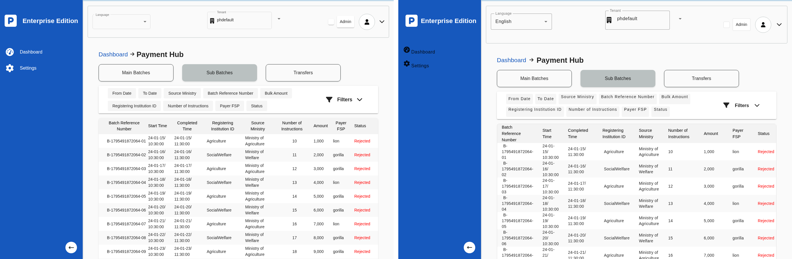 |
| beneficiaries | 4.74% | 1366x900 / 1366x900 | 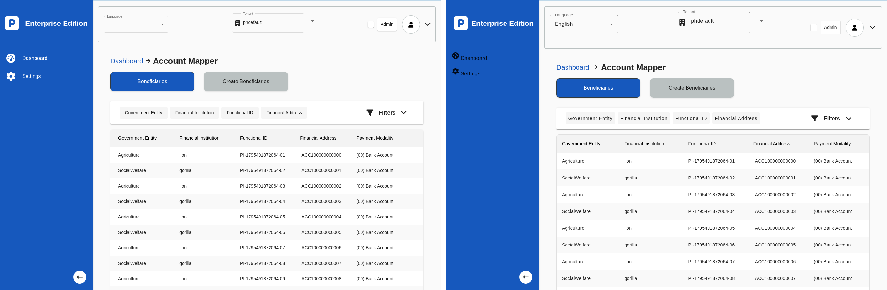 |
| bulk-import | 2.89% | 1366x900 / 1366x900 | 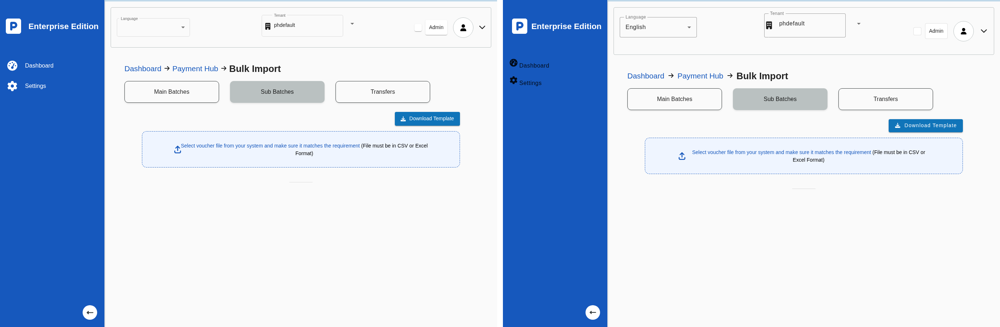 |
| dashboard | 1.76% | 1366x900 / 1366x900 | 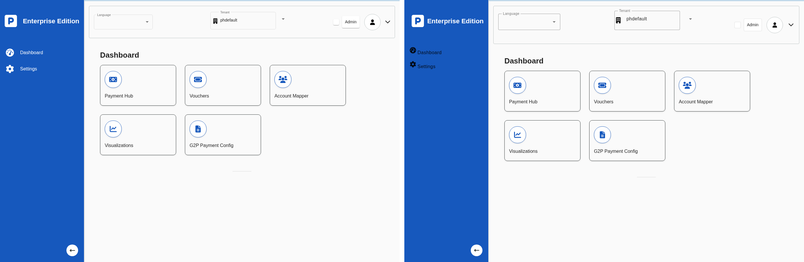 |
| g2p-config | 3.23% | 1366x900 / 1366x900 | 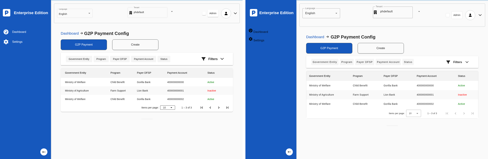 |
| g2p-create-validation | 4.30% | 1366x900 / 1366x900 | 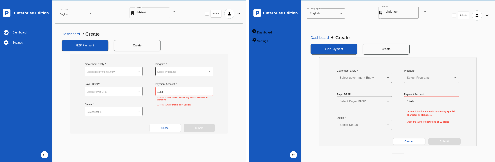 |
| g2p-edit | 3.53% | 1366x900 / 1366x900 | 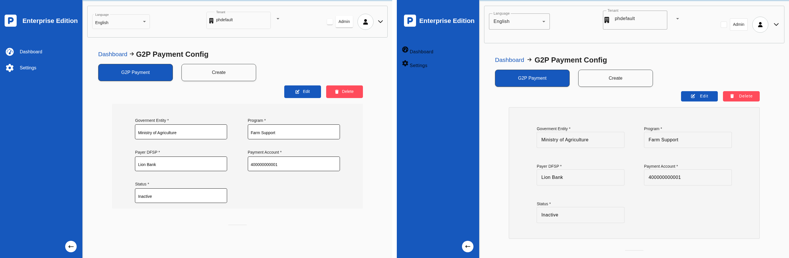 |
| login-validation | 8.79% | 1366x900 / 1366x900 | 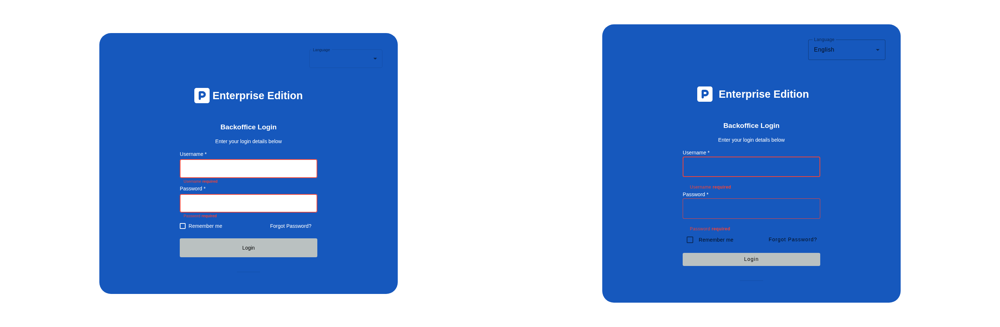 |
| login | 8.69% | 1366x900 / 1366x900 |  |
| not-found | 0.00% | 1366x900 / 1366x900 | 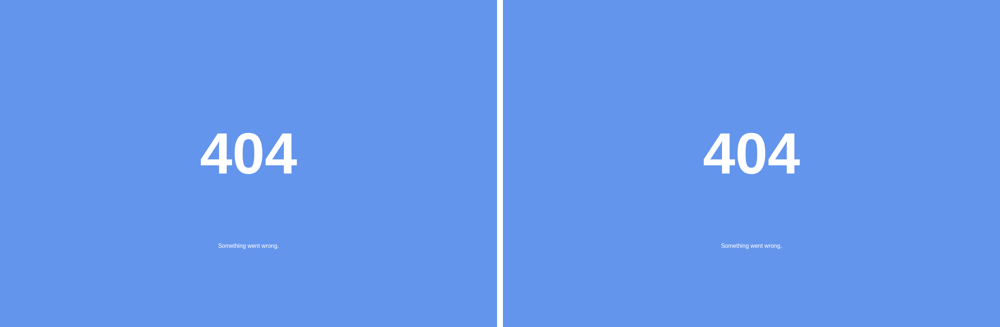 |
| settings | 1.27% | 1366x900 / 1366x900 | 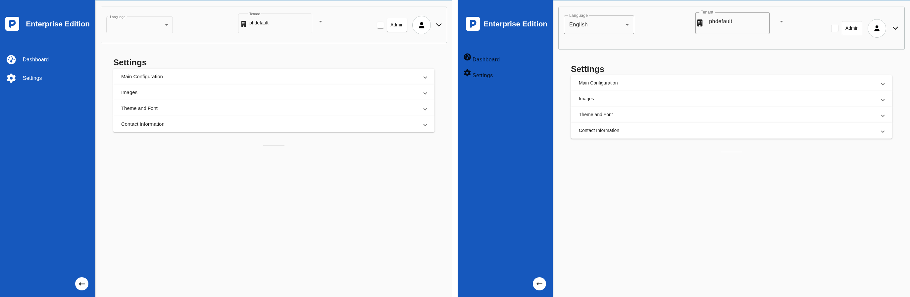 |
| system | 1.52% | 1366x900 / 1366x900 | 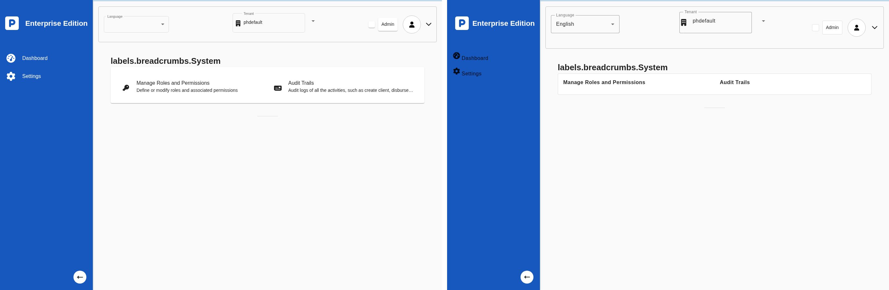 |
| transfers | 4.15% | 1366x900 / 1366x900 | 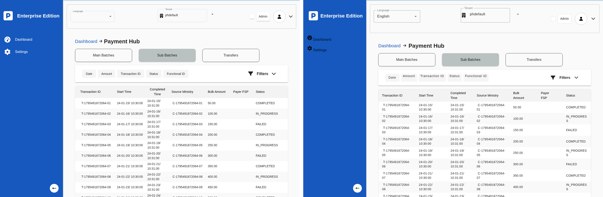 |
| visualizations | 1.08% | 1366x900 / 1366x900 | 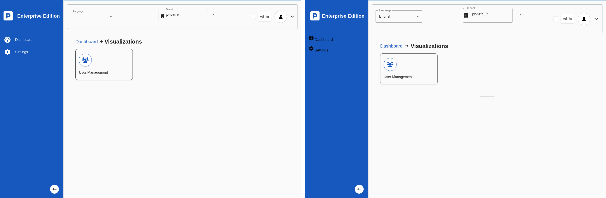 |
| vouchers | 4.14% | 1366x900 / 1366x900 | 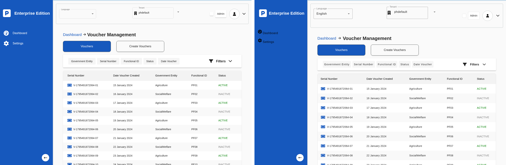 |
